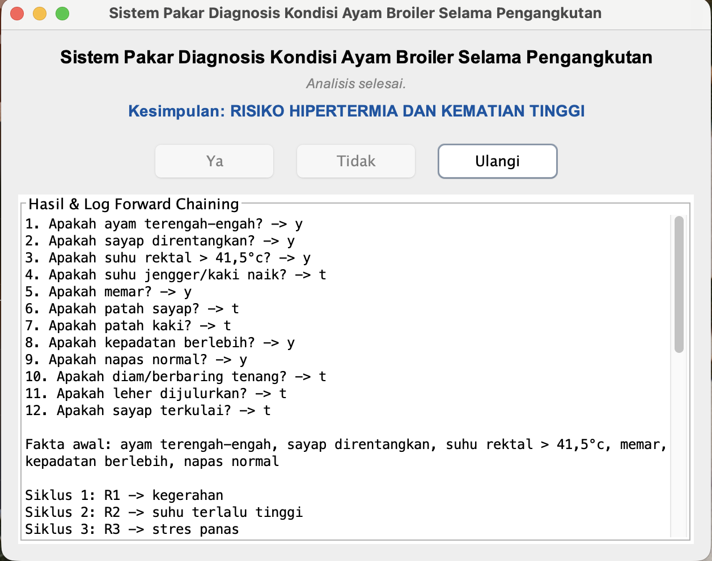
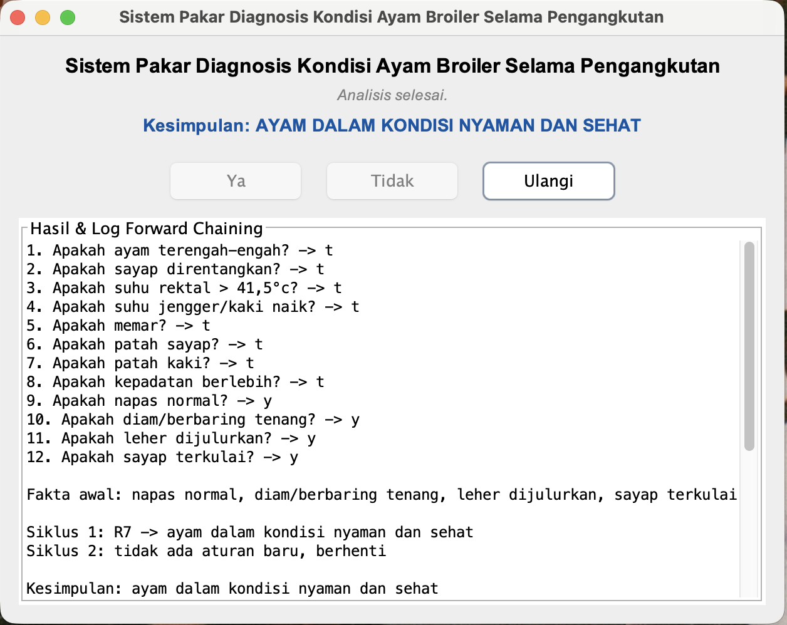
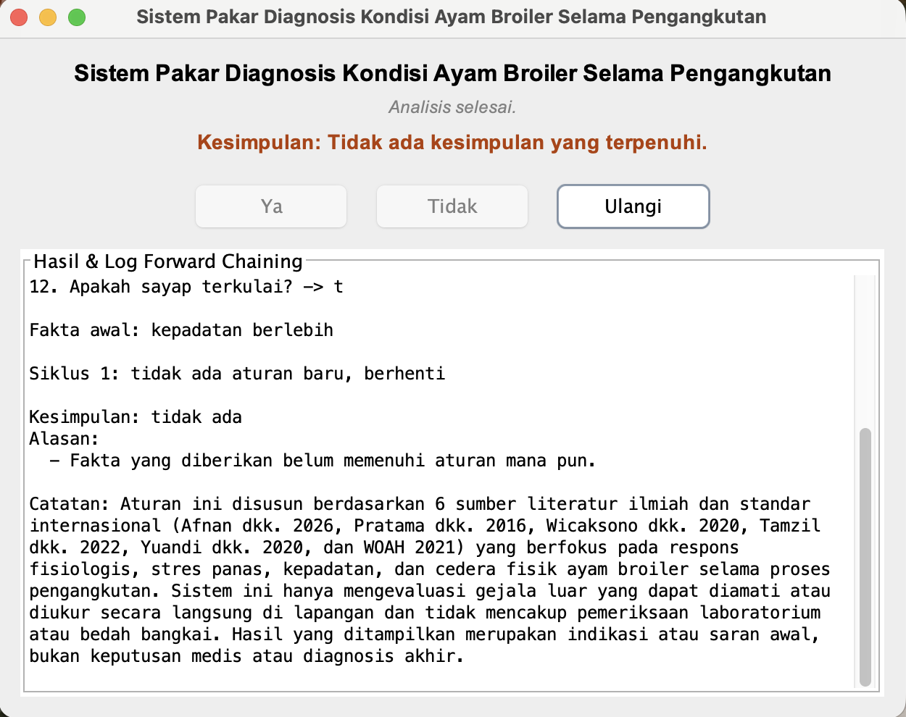

# ai-tugas5-F1D02310075

## 1. Identitas Mahasiswa
* **Nama:** Mika Khairan DJubikit
* **NIM:** F1D02310075

---

## 2. Topik & Cara Menjalankan Program
* **Topik:** Evaluasi dan diagnosis kondisi stres panas, cedera fisik, kepadatan, dan kenyamanan ayam broiler selama proses pengangkutan berdasarkan gejala yang dapat diamati atau diukur langsung di lapangan.
* **Bahasa & Versi:** Java (JDK 11 atau lebih baru) dengan antarmuka grafis Java Swing (tanpa *library* eksternal).
* **Struktur File:**
  ```text
  ai-tugas5-F1D02310075/
  ├── kb_ayam.json
  ├── SistemPakarAyamGUI.java
  ├── README.md
  └── screenshot/
      ├── kasus1_risiko_tinggi.png
      ├── kasus2_nyaman.png
      └── kasus3_negatif.png
  ```
* **Perintah Menjalankan Program:**
  Pastikan `SistemPakarAyamGUI.java` dan `kb_ayam.json` berada di folder yang sama, lalu jalankan melalui terminal:
  ```bash
  javac SistemPakarAyamGUI.java
  java SistemPakarAyamGUI
  ```

---

## 3. Daftar Sumber & Tabel Aturan IF-THEN

### Daftar Sumber Pengetahuan
1. **S1 — Afnan, Afnan & Ulupi (2026)**
   * **Judul:** *Factors causing weight loss and death of broiler chickens during the transportation process*
   * **Penerbit:** Faculty of Veterinary Medicine, Chiang Mai University (Jurnal *Veterinary Integrative Sciences* 24(1):1–12)
   * **URL:** https://www.researchgate.net/publication/394588361_Factors_causing_weight_loss_and_death_of_broiler_chickens_during_the_transportation_process
   * **Tanggal akses:** 12 November 2026
2. **S2 — Pratama dkk. (2016)**
   * **Judul:** *Pengaruh Perbedaan Transportasi Sistem M-CLOVE dengan Konvensional dan Jenis Kelamin terhadap Respon Fisiologis Ayam Broiler*
   * **Penerbit:** Departemen Ilmu Produksi dan Teknologi Peternakan, Fakultas Peternakan IPB University bersama HILPI (*Jurnal Ilmu Produksi dan Teknologi Hasil Peternakan* 4(1):204–211)
   * **URL:** https://journal.ipb.ac.id/ipthp/article/view/15717/11580
   * **Tanggal akses:** 12 November 2026
3. **S3 — Wicaksono dkk. (2020)**
   * **Judul:** *Oxidative Stress, Physiological Responses and Performance of Broilers Transported with Different Transportation Duration*
   * **Penerbit:** Departemen Ilmu Produksi dan Teknologi Peternakan, Fakultas Peternakan IPB University bersama HILPI (*JIPTHP* 8(3):137–143)
   * **URL:** https://journal.ipb.ac.id/ipthp/article/view/33158/20615
   * **Tanggal akses:** 12 November 2026
4. **S4 — Tamzil dkk. (2022)**
   * **Judul:** *Stres pengangkutan pada ternak unggas, pengaruh dan upaya penanggulangan*
   * **Penerbit:** Universitas Sebelas Maret (*Livestock and Animal Research* 20(1):48–58)
   * **URL:** https://jurnal.uns.ac.id/lar/article/view/53135/35282
   * **Tanggal akses:** 12 November 2026
5. **S5 — Yuandi dkk. (2020)**
   * **Judul:** *Implementation Assessment of Animal Welfare on Poultry Slaughter House in Kisaran City Asahan District*
   * **Penerbit:** Universitas Syiah Kuala (*Jurnal Medika Veterinaria* 14(1):1–13)
   * **URL:** https://www.researchgate.net/publication/408050679_1_Implementation_Assessment_of_Animal_Welfare_on_Poultry_Slaughter_House_in_Kisaran_City_Asahan_District
   * **Tanggal akses:** 12 November 2026
6. **S6 — WOAH (2021)**
   * **Judul:** *Terrestrial Animal Health Code, Chapter 7.10: Animal welfare and broiler chicken production systems*
   * **Penerbit:** World Organisation for Animal Health (WOAH, dahulu OIE)
   * **URL:** https://www.woah.org/fileadmin/Home/eng/Health_standards/tahc/2021/en_chapitre_aw_broiler_chicken.htm
   * **Tanggal akses:** 12 November 2026

### Tabel Aturan IF-THEN (`kb_ayam.json`)
| Aturan | IF (Syarat) | THEN (Kesimpulan) | Sumber |
| :--- | :--- | :--- | :--- |
| **R1** | ayam terengah-engah **OR** sayap direntangkan | kegerahan | S1, S6 |
| **R2** | suhu rektal > 41,5°C **OR** suhu jengger/kaki naik | suhu terlalu tinggi | S2, S3, S4 |
| **R3** | kegerahan **AND** suhu terlalu tinggi | stres panas | S2 |
| **R4** | memar **OR** patah sayap **OR** patah kaki | cedera fisik | S4, S1 |
| **R5** | cedera fisik **AND** stres panas | ayam melemah (risiko mati di perjalanan meningkat) | S1, S4 |
| **R6** | ayam melemah (risiko mati di perjalanan meningkat) **AND** kepadatan berlebih | risiko hipertermia dan kematian tinggi | S1 |
| **R7** | napas normal **AND** diam/berbaring tenang **AND** leher dijulurkan **AND** sayap terkulai | ayam dalam kondisi nyaman dan sehat | S2, S5 |

*Catatan rantai inferensi:* Hasil **R1** (`kegerahan`) dan **R2** (`suhu terlalu tinggi`) menjadi syarat **R3** (`stres panas`); hasil **R3** dan **R4** (`cedera fisik`) menjadi syarat **R5**; dan hasil **R5** menjadi syarat **R6**.

---

## 4. Metode Inferensi yang Dipilih
Metode yang digunakan adalah **Forward Chaining (FC)**, yaitu penelusuran berbasis data (*data-driven*) yang dimulai dari fakta-fakta gejala yang dijawab "Ya" oleh pengguna, lalu mencocokkannya dengan aturan IF-THEN di `kb_ayam.json` secara berulang sampai tidak ada kesimpulan baru yang dapat ditarik.

**Alasan pemilihan:** Pada skenario pemeriksaan ayam broiler di lapangan setelah atau selama pengangkutan, petugas mengamati sekumpulan gejala fisik yang tampak terlebih dahulu (seperti ayam terengah-engah, suhu tinggi, memar, atau berdesakan), baru kemudian menarik kesimpulan kondisi apa saja yang sedang dialami ayam tersebut. Alur *fakta $
ightarrow$ kesimpulan* pada Forward Chaining paling sesuai dengan proses evaluasi di lapangan.

---

## 5. Kasus Uji & Screenshot

| # | Jawaban "Ya" | Kesimpulan yang Diharapkan |
| :-: | :--- | :--- |
| 1 | `ayam terengah-engah`, `suhu rektal > 41,5°C`, `memar`, `kepadatan berlebih` | `risiko hipertermia dan kematian tinggi` (melalui rantai R1, R2 $
--> R3, R4 $
--> R5 $
--> R6) |
| 2 | `napas normal`, `diam/berbaring tenang`, `leher dijulurkan`, `sayap terkulai` | `ayam dalam kondisi nyaman dan sehat` (melalui R7) |
| 3 | `kepadatan berlebih` saja | **tidak ada** (kasus negatif — fakta belum cukup memicu aturan mana pun) |

### Screenshot Kasus 1 (Positif — Rantai Inferensi Penuh)


### Screenshot Kasus 2 (Positif — Kondisi Nyaman dan Sehat)


### Screenshot Kasus 3 (Negatif — Tidak Menghasilkan Kesimpulan)


---

## 6. Batas Keberlakuan
Aturan ini disusun berdasarkan 6 sumber literatur ilmiah dan standar internasional (Afnan dkk. 2026, Pratama dkk. 2016, Wicaksono dkk. 2020, Tamzil dkk. 2022, Yuandi dkk. 2020, dan WOAH 2021) yang berfokus pada respons fisiologis, stres panas, kepadatan, dan cedera fisik ayam broiler selama proses pengangkutan. Sistem ini hanya mengevaluasi gejala luar yang dapat diamati atau diukur secara langsung di lapangan dan tidak mencakup pemeriksaan laboratorium atau bedah bangkai. Hasil yang ditampilkan merupakan indikasi atau saran awal, bukan keputusan medis atau diagnosis akhir.

---

## 7. Penggunaan Alat Bantu AI
Alat bantu AI (Gemini) digunakan secara terbatas sebagai referensi tambahan, terutama untuk membantu *debugging* ringan pada pembacaan file JSON di Java, mengecek konsistensi penulisan aturan, serta merapikan format dokumentasi `README.md`. Pemilihan sumber, perancangan aturan IF-THEN, alur *Forward Chaining*, dan implementasi program utama disusun serta dipahami sendiri oleh penulis.